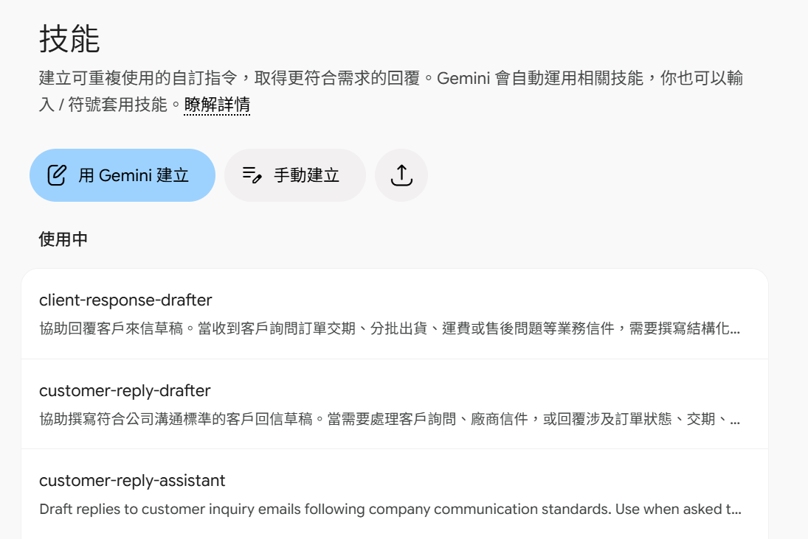

# Prompt 轉 SKILL

使用工具：<https://gemini.google.com/>

## Demo 1：新增一個對話，貼上下面的內容，看看結果

```text
【角色】你是一位資深業務助理，熟悉本公司的客戶溝通方式。

【任務】請幫我回覆下面這封客戶來信，寫一封回信草稿。

【背景】客戶是長期合作的廠商，回信會由我確認後寄出。

【步驟】
1. 先用一句話摘要對方要什麼
2. 開頭感謝來信，再逐一回答對方的每個問題
3. 結尾說明下一步與預計回覆時間

【輸出格式】一句話摘要＋回信草稿，回信 200 字以內。

【範例】結尾參考：「相關細節確認後，將於 10/10 前再與您聯繫。」

【限制】我沒提供答案的問題，寫【待確認：＿＿】，不要自行編造交期、價格或數量，因為寄錯資訊會影響客戶信任。

以下是來信：

主旨：詢問 PO-20261003 訂單交期與分批出貨

您好，

我是大成工業採購部的劉怡萱。我們在 10/3 下了一張訂單（PO-20261003），
品項為 IP-300 工業用幫浦 300 台，想跟您確認幾件事：

1. 原本約定 11/15 交貨，請問目前進度是否能如期？
2. 因為我們新產線提前啟用，是否可以先在 10/31 前出貨 100 台，其餘照原時程？
3. 若分批出貨，運費是否會另外計算？
4. 上次那批幫浦的漏水問題，改善報告什麼時候可以提供？

麻煩您於本週五前回覆，謝謝。

劉怡萱
大成工業股份有限公司採購部
```

## Demo 2：同一個對話，把提示詞轉成技能

在同一個對話輸入：

```text
根據這段提示詞建立一個新的技能，名稱用英文，描述及其它說明步驟用繁體中文
```

這時 Gemini 會建立一個 SKILL 出來。

- 如果沒有特別說要使用繁體中文，整份 SKILL 都會用英文
- 點選【⚙️ 齒輪（設定）】，選擇【技能】，就會看到剛剛建立的技能

  

- 使用方式：**每一次的測試都要開啟新的對話**
  - **測試一**：直接貼上信件 → 不會觸發技能
  - **測試二**：「幫我產生回信草稿」＋貼上信件 → 不會觸發技能，AI 自己會給承諾如期、免運費，還被 Gmail 接手準備寄出
  - **測試三**：使用 `/` 選擇技能 `/client-response-drafter`，貼上信件 → 會觸發技能，但結果依然有可能不正確
- Prompt 轉 SKILL 要測試是否有漏洞，有的話再將測試結果跟 SKILL 傳給 AI 修改
- 可以下載 SKILL，會是一個 zip 檔：
  - 可以直接匯入 Claude，用上面測試二的方式就能觸發技能
  - 無法直接匯入 ChatGPT，因為 zip 結構不同（`skills > 技能名稱 > SKILL.md`，外面多了一層 `skills` 資料夾）；也要用測試三的方式觸發技能，但不是用 `/`，要用 `@`

---

